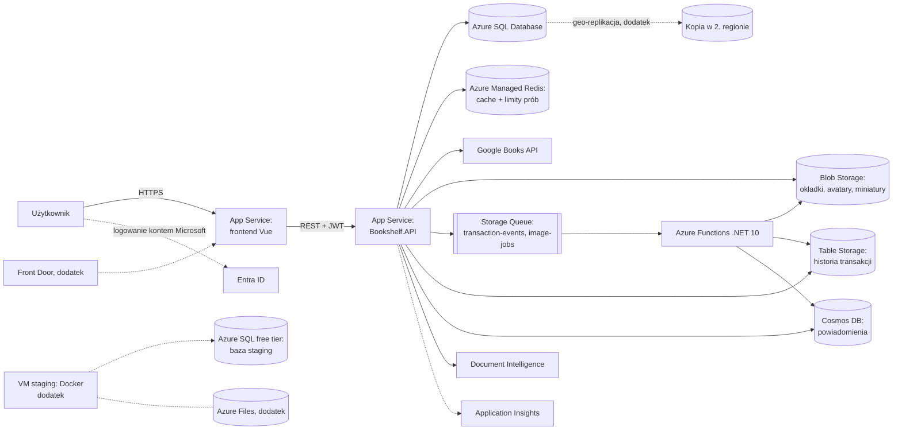

# Bookshelf × Azure: analiza i zakres projektu zaliczeniowego

> **Przedmiot:** Technologie chmury obliczeniowej · **Zespół:** Łukasz, Wojciech, Jakub (ocena wspólna)
> **Stan na:** 25.10.2026 · **Wersja:** 2 (po niezależnej weryfikacji) · **Status:** propozycja do akceptacji; nic nie jest jeszcze wdrożone ani zacommitowane

## 0. W skrócie

- **Bookshelf świetnie nadaje się na projekt.** To działająca aplikacja biznesowa: lokalna wymiana, wypożyczanie i sprzedaż książek, z transakcjami między użytkownikami. Ma pełny CRUD, a stos Microsoftu (.NET + SQL Server) przenosi się do Azure praktycznie bez zmian.
- **Strategia (zgodnie z ustaleniem):** najpierw **rdzeń na 5,0** w T1–T3, potem dodatki dla bezpieczeństwa.
- **Uwaga z weryfikacji:** rdzeń nie ma zapasu, bo każda pozycja jest liczona po maksimum. Dlatego dodatki 1–4 (bez zmian w kodzie aplikacji, +1,05) proponuję od razu przypisać do osób i terminów.
- **Rdzeń (5,0):**
  - hosting + baza + CRUD: 2,5
  - Redis (cache + limit prób): 0,5
  - Bloby: 0,5
  - Kolejki, Functions, Tabele, Cosmos DB, AI, Entra ID: po 0,25
- **Dodatki:**
  - VM ze środowiskiem testowym (staging): 0,5
  - Azure Files, Service Bus, Front Door (CDN, jeśli konto pozwoli): po 0,25
  - replikacja Azure SQL, autoskalowanie: po 0,15
- **Nie robimy:**
  - AKS: drogi i pracochłonny;
  - Cloud Services / Web Role / Worker Role: usługa wygaszana, a Functions liczymy już jako serverless, więc nie dublujemy.
- **Budżet:** ok. 35–50 USD na 4 tygodnie ze 100 USD konta studenckiego.
- **Podział:**
  - T1 Łukasz: fundament w chmurze + Redis + szkielet Functions;
  - T2 Wojciech: obrazy w Blob + zdarzenia i historia transakcji;
  - T3 Jakub: powiadomienia + AI + logowanie Microsoft;
  - T4 wszyscy: poprawki, demo, raport.

---

## 1. Stan repozytorium

- `main` na GitHubie: `7555be4 Merge pull request #22 … fix/edytowanie-oferty`. **Przed startem swojego tygodnia każdy robi `git pull`.**
- `docs/` i `CLAUDE.md` są w `.gitignore`, więc specyfikacje nie trafiają do zespołu przez git. Dlatego ten plan leży w `azure/`.

---

## 2. Czy Bookshelf nadaje się do projektu?

**Tak.** Aplikacja jest gotowa, więc baza 2,5 pkt to głównie wdrożenie, a większość czasu idzie na usługi Azure.

### 2.1 Co już jest

- **Backend .NET 8 Web API** (w T1 przeniesiony na .NET 10). 6 kontrolerów (`auth`, `users`, `books`, `userbooks`, `transactions`, `stats`), wzorzec Controller → Service → DbContext, JWT (BCrypt), globalny middleware wyjątków, proxy do Google Books z cache w pamięci procesu (24 h).
- **Dane.** EF Core + SQL Server, 2 migracje, flaga `RunMigrations` (automatyczne migracje przy starcie).
- **Encje:** `User`, `Book`, `Genre` (seed 10 gatunków), `UserBook` (oferta: wypożyczenie / wymiana / sprzedaż), `TransactionRequest` (statusy `pending → accepted/rejected → done`).
- **Pełny CRUD:** oferty (tworzenie, odczyt, edycja, usuwanie, upload okładki), profil, transakcje (prośba, akceptacja, odrzucenie, zakończenie, dane kontaktowe).
- **Frontend:** Vue 3 + TS + Vite + Pinia + Router (tryb history), 9 widoków, testy Vitest.
- **Docker Compose:** MSSQL + API + nginx (nginx przekierowuje `/api` do backendu).

### 2.2 Co w obecnym kodzie przeszkadza w chmurze (wynik weryfikacji)

| Problem | Gdzie | Skutek | Kiedy naprawiamy |
|---|---|---|---|
| `lib/api.ts` ma adres `/api` wpisany na sztywno; korzystają z niego logowanie, rejestracja i statystyki | `frontend/src/lib/api.ts:11`, `stores/auth.ts`, `stores/stats.ts` | Frontend pod własnym adresem (bez proxy): logowanie i rejestracja nie zadziałają | T1 |
| Wgrany avatar dostaje adres `/api/users/me/avatar/image` (endpoint tylko dla zalogowanych, „me" = oglądający) | `UserService.cs:99`, `UsersController.cs:11,98` | Inni użytkownicy nie widzą cudzych wgranych avatarów (błąd już dziś) | T2 |
| Obrazy (okładki, avatary) trzymane w bazie jako `varbinary(max)`; listy ofert mapowane po stronie aplikacji | `UserBookService.cs:80,117,352` | Każda lista ofert pobiera z bazy pełne obrazy, co jest ciężkie dla taniej bazy w chmurze | T2 (Blob) |
| Reset hasła wymaga tylko e-maila, nazwy użytkownika i miesiąca założenia konta, bez limitu prób | `AuthService.cs:84-89` | Po publicznym wdrożeniu łatwo przejąć konto zgadywaniem | T1 (limit prób w Redis) |
| Sekret JWT zapisany w repo | `appsettings.json` | Każdy z dostępem do repo może podrobić token | T1 (nowa wartość w App Settings) |
| Brak CORS | `Program.cs` | Frontend i API będą na różnych adresach | T1 |
| Pusty folder workflowów | `.github/workflows` | Brak automatycznego wdrażania | T1 |
| .NET 8 kończy wsparcie 10.11.2026 | `Bookshelf.API.csproj` | Wsparcie wygasa w trakcie T3 | T1: API przeniesione na .NET 10 (31.10); Functions od razu na .NET 10 |

### 2.3 Dlaczego pasuje: każda usługa ma naturalne miejsce

| Potrzeba Bookshelf | Usługa Azure |
|---|---|
| SQL Server lokalnie i w Dockerze | Azure SQL Database (ten sam silnik, migracje EF bez zmian) |
| Okładki i avatary trzymane dziś w bazie | Blob Storage |
| Zdarzenia transakcji i miniatury obrabiane w tle | Storage Queue + Azure Functions |
| Historia statusów transakcji | Table Storage |
| Powiadomienia w aplikacji („ktoś chce pożyczyć Twoją książkę") | Cosmos DB |
| Limity Google Books, statystyki, ochrona przed zgadywaniem haseł | Redis |
| Dodanie książki na podstawie zdjęcia okładki | AI (Document Intelligence, OCR) |
| Logowanie kontem Microsoft | Entra ID |

---

## 3. Strategia punktowa

### 3.1 Zasada

- Wartości z regulaminu są maksymalne, a usługa użyta powierzchownie może dostać mniej. Dlatego **każda usługa obsługuje konkretną funkcję** widoczną na demo i w raporcie.
- **Rdzeń nie zależy od żadnego dodatku.**
- Rdzeń liczy wszystko po maksimum, w tym bloby za 0,5, czyli górną granicę widełek. Gdyby dwie pozycje po 0,25 zostały ocenione na 0, rdzeń dałby 4,5. Stąd propozycja, żeby dodatki 1–4 zaplanować z osobą i terminem.

### 3.2 Decyzja dla każdej pozycji z listy

Legenda: ✅ rdzeń · ➕ dodatek · ❓ zależy od testu w dniu 0 · ❌ nie robimy

| Pozycja (maks.) | Decyzja | Zastosowanie w Bookshelf | Kiedy |
|---|---|---|---|
| Aplikacja w chmurze + baza + CRUD (2,5) | ✅ | Frontend i API na App Service (dwie aplikacje na jednym planie B1), dane w Azure SQL Database; istniejący CRUD ofert, profili i transakcji | T1 |
| Redis cache (0,5) | ✅ | Azure Managed Redis w dwóch rolach: (1) rozproszony cache wyników Google Books, gatunków i statystyk; (2) limit prób logowania, rejestracji, resetu hasła i wysyłania próśb | kod T1, zasób T3 |
| Bloby (0,25–0,5) | ✅ cel 0,5 | Okładki i avatary przeniesione z bazy do Blob Storage; dostęp przez krótkotrwałe linki SAS; miniatury; reguła cyklu życia | T2 |
| Kolejki (0,25) | ✅ | Storage Queue: `transaction-events` (zdarzenia transakcji) i `image-jobs` (miniatury) | T2 |
| Serverless functions (0,25) | ✅ | Azure Functions (.NET 10 isolated): `ProcessTransactionEvent`, `GenerateThumbnail` | T2 |
| Tabele (0,25) | ✅ | Table Storage: historia statusów każdej transakcji, widoczna w aplikacji | T2 |
| Cosmos DB (0,25) | ✅ | Powiadomienia w aplikacji (dzwonek z licznikiem), dokumenty per użytkownik z automatycznym wygasaniem (TTL); free tier | T3 |
| AI (0,25…) | ✅ | Document Intelligence (model „read", OCR): „Rozpoznaj książkę ze zdjęcia okładki" → wyszukanie w Google Books → podpowiedzi przy dodawaniu | T3 |
| Azure AD / Entra ID (0,25) | ✅ | „Zaloguj przez Microsoft" obok obecnego logowania (konto identyfikowane po `tid` + `oid`, bez łączenia po e-mailu) | T3 |
| Replikacja bazy danych (0,15) | ➕ | Aktywna geo-replikacja Azure SQL: czytelna kopia w drugim regionie | dodatek 1 |
| Autoscaling witryny (0,15) | ➕ | Reguły autoskalowania App Service (S1, 1–3 instancje, CPU) + test obciążeniowy | dodatek 2 |
| Wirtualne maszyny (0,5) | ➕ | Środowisko staging na VM: Docker + gotowe obrazy (API + frontend) z GitHub Actions, baza staging w Azure SQL free tier. Dobre porównanie IaaS vs PaaS do raportu | dodatek 3 |
| Files storage (0,25) | ➕ | Udział Azure Files montowany na VM staging (konfiguracja, logi) | dodatek 4 |
| Service Bus (0,25) | ➕ | Topic `transaction-events` z subskrypcjami (historia, powiadomienia) zamiast kolejki zdarzeń. `image-jobs` zostaje na Storage Queue, więc pozycje się nie dublują | dodatek 5 |
| CDN (0,25) | ❓ | Front Door przed frontendem tylko w tygodniu demo. Klasyczny CDN nie przyjmuje nowych profili, a na kontach studenckich Front Door ma dławione pasmo; opłata bazowa ok. 35 USD/mies., liczona godzinowo | dodatek 6 |
| Worker role (0,25) | ❌ | Cloud Services są wygaszane; Functions liczymy jako serverless, więc nie dublujemy | – |
| Skalowalna Web Role jako cloud service (0,25) | ❌ | Cloud Services (extended support) wygaszane do 31.03.2027; skalowalną witryną jest App Service | – |
| Azure Kubernetes Service (0,5) | ❌ | Koszt węzłów i load balancera, limity kont studenckich, dużo pracy przy hostingu, który mamy na App Service | – |
| Inne niewymienione | ➕ przy okazji | Application Insights, GitHub Actions, opcjonalnie e-maile przez Azure Communication Services. Nie liczymy ich w planie | T1–T3 |

### 3.3 Sumy

| Wariant | Suma |
|---|---|
| Rdzeń | **5,00** |
| Rdzeń + dodatki 1–4 (bez zmian w kodzie aplikacji) | **6,05** |
| Rdzeń + wszystkie dodatki | 6,55 |

---

## 4. Architektura docelowa

### 4.1 Kluczowe przepływy

1. **Obrazy.**
   - Upload okładki lub avatara idzie przez API (multipart, jak dziś). API zapisuje plik w Blob Storage, a w bazie zostaje tylko nazwa pliku.
   - Nowe anonimowe `GET /api/users/{id}/avatar` i istniejący `GET /api/userbooks/{id}/cover/image` przekierowują na link SAS: tylko do odczytu, na konkretny plik, HTTPS, ważny kilkanaście minut.
   - Upload wrzuca też zlecenie do `image-jobs`, a `GenerateThumbnail` robi miniaturę. Dopóki miniatury nie ma, lista pokazuje oryginał.
2. **Transakcja.**
   - API publikuje zdarzenie do `transaction-events` po każdej zmianie statusu. Ścieżek jest 6: prośba, akceptacja, automatyczne odrzucenie pozostałych przy akceptacji, odrzucenie, zakończenie, automatyczne odrzucenie przy zakończeniu.
   - `ProcessTransactionEvent` zapisuje wpis historii w Table Storage (T2) i powiadomienie dla drugiej strony w Cosmos DB (T3).
3. **Google Books i statystyki.** Wynik wyszukiwania (klucz = znormalizowane zapytanie) leży w Redis 24 h, gatunki i statystyki krócej. W przeciwieństwie do cache w pamięci procesu przetrwa to restart i jest wspólne dla wszystkich instancji.
4. **Limit prób.** Licznik w Redis (per IP i per e-mail) dla logowania, rejestracji, resetu hasła i wysyłania próśb; po przekroczeniu API zwraca 429. To chroni słaby dziś reset hasła.
5. **Logowanie Microsoft.**
   - Przycisk „Zaloguj przez Microsoft" (MSAL) pobiera token, który trafia do `POST /api/auth/microsoft`. API weryfikuje go biblioteką Microsoft.Identity.Web.
   - Użytkownika identyfikujemy po `tid` + `oid` (nowa tabela `ExternalLogins`). Pierwsze logowanie zakłada nowe konto, a API wydaje zwykły JWT aplikacji.
   - **Nie łączymy kont po e-mailu.** Microsoft wprost odradza używanie e-maila do autoryzacji, bo przy kontach z dowolnej organizacji to pole może ustawić administrator obcego tenanta (ryzyko przejęcia konta).
6. **AI.**
   - „Rozpoznaj książkę ze zdjęcia" w widoku dodawania zmniejsza zdjęcie w przeglądarce (poniżej 4 MB) i wysyła je do `POST /api/books/recognize`.
   - Document Intelligence (model „read") odczytuje tekst okładki, ten tekst trafia do wyszukiwarki Google Books (z cache), a użytkownik wybiera właściwą książkę.
7. **Powiadomienia.** Frontend co 30–60 s pyta `GET /api/notifications` i pokazuje dzwonek z liczbą nieprzeczytanych; `PUT …/read` oznacza je jako przeczytane.

### 4.2 Uzasadnienie wyboru usług (do sekcji „Założenia" raportu)

- **App Service:** zarządzany hosting .NET bez administrowania serwerem; skalowanie, deploy z GitHub Actions, sekrety w App Settings.
- **Frontend na App Service:** druga aplikacja (Node 22, `pm2 serve --spa`) na planie API, więc bez dodatkowych kosztów i z tym samym sposobem wdrażania co API. Static Web Apps odpadło, bo polityka konta studenckiego nie dopuszcza żadnego z jego regionów (sprawdzone 01.11).
- **Azure SQL Database:** ten sam silnik co lokalny SQL Server, więc migracje EF Core działają bez zmian; zarządzane kopie zapasowe, geo-replikacja.
- **Blob Storage:** tani magazyn plików zamiast `varbinary` w bazie. Lżejsze zapytania (listy przestają ciągnąć obrazy) i dostęp do plików po URL.
- **Storage Queue + Functions:** wolniejsze zadania w tle, bez serwera, z automatycznym skalowaniem; API odpowiada od razu.
- **Table Storage:** tani zapis wielu prostych rekordów historii (klucz-wartość, tylko dopisywanie).
- **Cosmos DB:** dokumenty per użytkownik, szybki odczyt po kluczu partycji, automatyczne wygasanie starych powiadomień.
- **Redis:** wspólny cache i liczniki dla wszystkich instancji, atomowe operacje i wygasanie kluczy.
- **Document Intelligence:** OCR bez trenowania modelu. Wybrany zamiast Azure AI Vision, którego funkcja Read jest wycofywana do 25.09.2028.
- **Entra ID:** logowanie zaufanym kontem Microsoft bez zakładania kolejnego hasła.

### 4.3 Zasady wspólne dla wszystkich tygodni

- **Każda integracja ma lokalny zamiennik**, żeby kolejna osoba mogła pracować u siebie:
  - Redis: `AddDistributedMemoryCache()`, gdy nie ma connection stringa, a błąd cache traktujemy jak brak trafienia; serwis `redis` dodany do `docker-compose`;
  - Storage: Azurite;
  - Cosmos DB: emulator albo osobny kontener „dev" w chmurze.
- **Sekrety tylko** w App Settings albo lokalnych `.env` / user-secrets. Nigdy w repo.
- **Region:** jeden główny z listy dozwolonych w subskrypcji. Usługi AI mogą stać w innym regionie, jeśli w głównym nie ma darmowego tieru.

### 4.4 Pułapki techniczne (dla wykonawców)

- **Azure SQL:**
  - na start free tier (szczegóły niżej); jeśli podniesiemy plan, Basic (5 DTU, 2 GB) wystarcza na demo, ale łatwo go „zatkać" testem obciążeniowym;
  - zapora: „Allow Azure services" + adresy IP naszych komputerów;
  - `RunMigrations=true` w App Settings odpala istniejące automatyczne migracje.
- **Azure SQL free tier** (0 USD, do 10 baz): po wyczerpaniu 100 tys. vCore-sekund w miesiącu baza zatrzymuje się do początku kolejnego miesiąca. Nie może być w grupie failover ani być kopiowana. Na start (decyzja z 31.10) to także baza główna; przed geo-replikacją (dodatek 1) albo gdy limit zacznie się kończyć, podnosimy ją do Basic (zmiana jednokierunkowa). Otwarte połączenie z SSMS blokuje auto-pauzę.
- **App Service:** do autoskalowania wystarczy tier Standard (S1), na co dzień B1; `ASPNETCORE_ENVIRONMENT=Production`.
- **Frontend:**
  - `lib/api.ts` ma korzystać z `getApiBaseUrl()` (albo przechodzimy na `apiRequest`);
  - build produkcyjny ma się wywalić, gdy `VITE_API_BASE_URL` jest pusty;
  - każdy adres SPA ma dostawać `index.html`: `pm2 serve --spa` (Startup Command aplikacji frontendu).
- **CORS:** `AddCors` z adresem aplikacji frontendu i `http://localhost:5173`; `UseCors()` przed uwierzytelnianiem.
- **Azure Managed Redis:** StackExchange.Redis obsługuje klaster bez dodatkowej konfiguracji. Uwierzytelnianie jest domyślnie przez Entra ID, więc najprościej świadomie włączyć klucze dostępu. Port 10000, TLS.
- **Blob:**
  - anonimowy odczyt jest domyślnie wyłączony, więc obrazy wydajemy przez link SAS;
  - reguła cyklu życia nie może archiwizować używanych obrazów, bo z warstwy Archive nie da się ich od razu odczytać;
  - w chmurze startujemy z pustą bazą, więc kolumny `varbinary` usuwamy migracją bez przenoszenia danych.
- **Functions:**
  - **.NET 10** isolated, plan Flex Consumption (sprawdzić region) albo Consumption;
  - trigger kolejki domyślnie oczekuje Base64, a `QueueClient` wysyła zwykły tekst. Trzeba ustawić `MessageEncoding = Base64` w kliencie (albo `messageEncoding: none` w host.json), inaczej komunikaty lądują w kolejce „poison".
- **Cosmos DB:** free tier tylko jeden na subskrypcję; kontener 400 RU/s, partycja `/userId`, TTL 30 dni.
- **Document Intelligence:** darmowy tier F0 (500 stron/mies.) nie jest dostępny w każdym regionie. Usuniętych zasobów AI nie zakładamy od nowa „na próbę": są przez 48 h w koszu i blokują darmowy slot.
- **Entra ID:** rejestracja aplikacji typu „konta w dowolnej organizacji + osobiste konta Microsoft", adresy przekierowania SPA (adres frontendu + localhost). Użytkownikowi z Microsoft uzupełniamy imię i nazwisko z tokenu, a miasto prosimy uzupełnić w profilu. `PasswordHash` ustawiamy na losową wartość, bo pole jest wymagane.
- **E-mail przez Azure Communication Services** (opcja): domena zarządzana przez Azure ma limit 5 maili/min i 10 na godzinę.

---

## 5. Konto, dostęp i koszty

**Dostęp.**

- Nie dzielimy się hasłem do jednego konta. Właściciel subskrypcji zaprasza pozostałych do tenanta Entra ID i nadaje im **Contributor (albo Owner) na całej subskrypcji** studenckiej, która służy tylko temu projektowi.
- Rola na samej grupie zasobów nie wystarczy: rejestracja dostawców usług (resource providers) i usuwanie zasobów AI z kosza wymagają roli na poziomie subskrypcji.

**Konto Azure for Students:** 100 USD na 12 miesięcy, bez karty.

- **Przez 12 miesięcy darmowe:** VM B1s / B2pts v2 / B2ats v2 (750 h/mies.).
- **Bez limitu czasu darmowe:** Cosmos DB free tier, Azure SQL free tier (do 10 baz), darmowe tiery usług AI.
- **Po wyczerpaniu kredytu** subskrypcja jest wyłączana (bez rachunku, ale aplikacja przestaje działać).
- **Alerty budżetu w Cost Management** mogą nie być dostępne dla tego typu subskrypcji. Stan kredytu sprawdzamy w Education hub (dane z opóźnieniem do 72 h).

| Zasób | Konfiguracja | Szac. koszt / 4 tyg. (USD) |
|---|---|---|
| App Service | B1 Linux (0,018 $/h); S1 (0,095 $/h) tylko na test autoskalowania | 12–15 |
| Azure SQL Database | free tier na start (0 $); Basic (ok. 4,83 $/mies.), jeśli podniesiemy | 0–4,5 |
| Azure Managed Redis | B0 (0,021 $/h), od T1 | ok. 13–14 |
| Frontend (druga aplikacja na planie API) | w cenie B1 | 0 |
| Storage (Blob, Queue, Table, Files) | LRS, małe wolumeny | ok. 1 |
| Functions | Flex Consumption / Consumption | ok. 0 |
| Cosmos DB | free tier, 400 RU/s | 0 |
| Document Intelligence | F0 | 0 |
| Dodatki | geo-replika SQL Basic (ok. 2 tyg.) ok. 2,5; VM z darmowej puli + publiczny IP (płatny także po wyłączeniu VM) ok. 2–3; Service Bus Standard ok. 3–5; Front Door kilka dni ok. 3–5 | 5–15 |
| **Razem** | | **ok. 30–50** |

Ceny dla `polandcentral` z Azure Retail Prices API (10.2026). W wybranym `germanywestcentral` są takie same albo niższe: App Service B1 Linux 0,018 $/h, Redis B0 0,019 $/h (sprawdzone 01.11).

**Po demo przechodzimy w tryb oszczędny:** S1 → B1, VM wyłączona, bez Front Door. Utrzymanie kosztuje wtedy ok. 1 USD dziennie. Jeśli ocena przesunie się o kilka tygodni, nadal mieścimy się w kredycie. Po ocenie usuwamy wszystko.

---

## 6. Podział pracy: 3 tygodnie + tydzień na poprawki i raport

### 6.1 Zasady współpracy

1. **W danym tygodniu kod aplikacji na `main` zmienia tylko jego właściciel.** Pozostali w tym czasie przygotowują się albo robią dodatki infrastrukturalne, które nie dotykają kodu aplikacji (pliki tylko w `azure/…`).
2. **Każdy commituje i pushuje sam.** `main` musi się zawsze budować i działać.
3. **Zrzuty ekranu i notatki do raportu robimy w trakcie** (portal, konfiguracja, kod, efekt w aplikacji), ale trzymamy je u siebie, nie w repo: repo jest publiczne, a na zrzutach widać m.in. ID subskrypcji i e-maile. `azure/raport/` jest w `.gitignore`.
4. **Na koniec tygodnia wiadomość do Łukasza:** co zrobione, czego nie, co przechodzi dalej, plus zrzuty. Łukasz weryfikuje tydzień, zanim przekaże pracę następnej osobie.

### 6.2 Dzień 0 (Łukasz, ok. 2–3 h; pozostali tylko logują się i sprawdzają dostęp)

Stan 01.11: ✅ zrobione, → w zakresie innego tygodnia.

- ✅ Lista dozwolonych regionów (polityka konta studenckiego) i wybór regionu.
- ✅ Wojciech i Jakub mają rolę Contributor na subskrypcji.
- ✅ Rejestracja dostawców usług: Web, Sql, Storage, Cache, DocumentDB, CognitiveServices, ServiceBus, Insights, OperationalInsights, AlertsManagement, Compute, Network.
- → T3: **docelowe** (nie próbne) utworzenie zasobów z darmowymi slotami: Cosmos DB free tier i Document Intelligence F0.
- ✅ Dostępność pozostałych usług (Azure Managed Redis B0, Azure SQL Basic, Functions Flex Consumption): wszystkie mają ceny w Germany West Central; SKU sprawdzamy przy tworzeniu.
- → T3: czy można zarejestrować aplikację w Entra ID.
- → T4 (Łukasz): czy da się utworzyć Front Door (dodatek 6). Zasób od razu usuwamy.

### 6.3 T1: Fundament + Redis + szkielet Functions (Łukasz, 26.10–01.11) · rdzeń 3,0

Stan 01.11: punkty 1–4 i 7 zrobione, aplikacja działa w chmurze (wyszukiwanie Google Books czeka na klucz), kod Redisa jest gotowy. Zasób Redis jest w zakresie T3, a punkt 6 (Storage, Function App, `IEventPublisher`) w zakresie T2.

1. **Azure SQL** (free tier na start) + zapora.
2. **App Service** (Linux, B1). App Settings:
   - connection string;
   - **nowy** sekret JWT;
   - klucz Google Books;
   - `RunMigrations=true`.
3. **Frontend pod chmurę:** poprawka `lib/api.ts`; druga aplikacja na planie API (Node 22, `pm2 serve --spa`) + `VITE_API_BASE_URL`; **CORS** w `Program.cs`.
4. **GitHub Actions:** workflow API i workflow frontendu.
5. **Redis:**
   - Azure Managed Redis B0; `IDistributedCache` z zamiennikiem lokalnym; serwis `redis` w `docker-compose`;
   - cache Google Books, gatunków i statystyk;
   - limit prób dla logowania, rejestracji, resetu hasła i wysyłania próśb (429).
6. **Szkielet dla T2–T3:**
   - konto Storage;
   - Function App (.NET 10) z workflowem deploy i pustą funkcją z triggerem kolejki;
   - w API interfejs `IEventPublisher` (jeszcze bez zdarzeń).
7. **Test całości w chmurze:** rejestracja i logowanie pod adresem frontendu, dodanie książki, przeglądanie, transakcja.

**Minimum do przekazania:**

- aplikacja działa pod adresem frontendu, z API na App Service i danymi w Azure SQL;
- deploy z `main` jest automatyczny;
- ponowne wyszukanie tej samej książki trafia w Redis;
- po kilku błędnych logowaniach API zwraca 429;
- Function App jest wdrożona;
- przekazanie + zrzuty.

### 6.4 T2: Obrazy w chmurze, zdarzenia i historia (Wojciech, 02.11–08.11) · rdzeń 1,25

Instrukcja dla wykonawcy: `azure/t2/01-zadania-i-instrukcja.md`.

0. **Fundament:** konto Storage, Function App (.NET 10, Flex Consumption) z workflowem wdrożenia i funkcją z triggerem kolejki, w API `IEventPublisher`.
1. **Blob:**
   - avatary i okładki w kontenerach `avatars` i `covers`, w bazie tylko nazwa pliku; migracja usuwa kolumny `varbinary`;
   - anonimowy `GET /api/users/{id}/avatar` + istniejący endpoint okładki przekierowują na link SAS; poprawka adresów avatarów we frontendzie (błąd z sekcji 2.2);
   - usuwanie okładki usuwa plik;
   - reguła cyklu życia (bez archiwizacji używanych plików).
2. **Zdarzenia:** `IEventPublisher` → Storage Queue `transaction-events` (Base64) ze wszystkich 6 ścieżek w `TransactionService`.
3. **Historia:** `ProcessTransactionEvent` → Table Storage `TransactionHistory` (PartitionKey = id transakcji); `GET /api/transactions/{id}/history`, a we frontendzie oś czasu w karcie transakcji.
4. **Miniatury (na koniec):** `image-jobs` → `GenerateThumbnail` (ImageSharp) → `thumbnails`; lista pokazuje oryginał, dopóki miniatury nie ma. Jeśli zabraknie czasu, miniatury przechodzą na T4. Są ważnym argumentem za 0,5 pkt dla blobów.

**Minimum do przekazania:**

- obrazy leżą w Blob Storage (widać to w portalu i w aplikacji);
- cudze avatary są widoczne;
- po akcjach na transakcji historia jest widoczna w aplikacji;
- zrzuty.

### 6.5 T3: Powiadomienia, AI i logowanie Microsoft (Jakub, 09.11–15.11; 11.11 święto) · rdzeń 0,75 + Redis 0,5

0. **Na start:**
   - klucz Google Books w App Settings API (do tego czasu wyszukiwanie Google Books w chmurze nie działa);
   - Redis: Azure Managed Redis B0, `ConnectionStrings__Redis` w API, test cache i limitu prób (429); kod jest gotowy;
   - Cosmos DB free tier i Document Intelligence F0 (docelowe zasoby) oraz sprawdzenie rejestracji aplikacji w Entra ID.
1. **Cosmos DB:**
   - kontener `notifications` (partycja `/userId`, TTL 30 dni);
   - zapis powiadomienia w `ProcessTransactionEvent`, a gdyby funkcja nie była gotowa, tymczasowo z API;
   - `GET /api/notifications`, `PUT …/read`;
   - dzwonek z licznikiem w `AppNavbar`.
2. **AI:** Document Intelligence F0, `POST /api/books/recognize`; przycisk „Rozpoznaj ze zdjęcia" w `AddBookView` (zdjęcie zmniejszane w przeglądarce) z listą trafień z Google Books.
3. **Entra ID:**
   - rejestracja aplikacji;
   - przycisk „Zaloguj przez Microsoft" (MSAL);
   - `POST /api/auth/microsoft` z weryfikacją przez Microsoft.Identity.Web;
   - tabela `ExternalLogins` (`tid` + `oid`), bez łączenia kont po e-mailu.

   Plan B, gdyby rejestracja aplikacji była zablokowana: logowanie API do Azure SQL i Storage tożsamością zarządzaną (bez haseł).
4. **(dodatek 5, tylko jeśli zostanie czas do 15.11)** Service Bus zamiast kolejki zdarzeń. W T4 już tego nie zaczynamy.

**Minimum do przekazania:**

- powiadomienia pojawiają się po akcjach na transakcji;
- rozpoznanie książki ze zdjęcia działa;
- logowanie kontem Microsoft działa;
- zrzuty.

### 6.6 Dodatki: osoby i terminy

| # | Dodatek | Pkt | Nakład | Kto, do kiedy |
|---|---|---|---|---|
| 1 | Geo-replikacja Azure SQL (czytelna kopia w 2. regionie, pokaz odczytu z kopii) | 0,15 | ok. 0,25 dnia | Łukasz, do 08.11. Tylko portal |
| 2 | Autoskalowanie: B1 → S1, reguły CPU 1–3 instancje, test k6 na endpoint obciążający CPU (np. logowanie z BCrypt, z limitem prób podniesionym dla konta testowego), zrzuty metryk, powrót na B1. Po T2, gdy obrazy nie obciążają już bazy | 0,15 | ok. 0,5 dnia | Jakub, do 15.11 |
| 3 | VM staging: B2ats v2 (x64), Docker; obrazy API i frontendu budowane w GitHub Actions i trzymane w GHCR; `docker-compose.staging.yml` bez kontenera bazy (baza staging w Azure SQL free tier); SSH tylko kluczem, port 22 dostępny tylko z IP zespołu, porty 1433 i 8080 zamknięte | 0,5 | ok. 1 dzień | Wojciech po T2, do 15.11. Pliki tylko w `azure/vm/` |
| 4 | Azure Files: udział montowany na VM staging (plik `.env`, logi) | 0,25 | ok. 0,5 dnia | Wojciech, razem z dodatkiem 3 |
| 5 | Service Bus: topic `transaction-events` z subskrypcjami historii i powiadomień | 0,25 | ok. 0,5 dnia | Jakub, tylko do 15.11 |
| 6 | Front Door przed frontendem na tydzień demo (jeśli test w dniu 0 przeszedł) | 0,25 | ok. 0,25 dnia | Łukasz, T4 |

### 6.7 T4: Poprawki, demo, raport (wszyscy, 16.11–22.11, oddanie na ostatnich zajęciach)

- Na początku tygodnia zamrażamy nowe funkcje, dalej tylko poprawki. Wyjątki: zaległe miniatury z T2 i dodatek 6, który nie zmienia kodu.
- Scenariusz demo: rejestracja i logowanie (także kontem Microsoft) → dodanie książki ze zdjęcia → oferta z okładką z Blob → prośba o transakcję → powiadomienie + historia → (dodatki) replika, autoskalowanie, staging na VM.
- **Raport:** każdy opisuje swoją część (sekcje „Funkcjonalność" i „Przygotowanie projektu" ze zrzutami). Łukasz składa całość.
- Po demo tryb oszczędny, aplikacja działa do wystawienia oceny. Po ocenie sprzątamy zasoby.

### 6.8 Bilans

| Osoba | Rdzeń (pkt) | Dodatki (pkt) | Nakład |
|---|---|---|---|
| Łukasz (T1, dodatki 1 i 6, weryfikacja i raport) | 2,50 | 0,40 | ok. 4,5 osobodnia |
| Wojciech (T2, dodatki 3 i 4) | 1,25 | 0,75 | ok. 5,5 osobodnia |
| Jakub (T3 z Redisem, dodatki 2 i 5) | 1,25 | 0,40 | ok. 5 osobodni |
| **Razem** | **5,00** | **1,55** | |

Podział z 01.11: T2 obejmuje też konto Storage, Function App i `IEventPublisher`; T3 obejmuje też zasób Redis, sprawdzenia z dnia 0 i dodatek 2. Łukasz weryfikuje T2 i T3 i składa raport.

T2 i T3 można zamienić według umiejętności: T2 to bardziej backend, Azure Storage i Linux (VM), T3 bardziej full-stack (frontend + API + logowanie).

---

## 7. Ryzyka i plan B

| Ryzyko | Plan B |
|---|---|
| Polityka konta studenckiego blokuje region lub usługę | Sprawdzenie w dniu 0; inny dozwolony region; usługi AI w osobnym regionie |
| Nie da się utworzyć Azure Managed Redis | Wcześnie sprawdzić kreatorem do etapu walidacji (bez tworzenia, bez kosztu); inny dozwolony region; w ostateczności Redis na VM (słabszy argument do punktów) i awans dodatku 3 do rdzenia |
| Darmowa baza zużyje miesięczny limit (100 tys. vCore-sekund) i zatrzyma się do 1.12, czyli przed demo | Raz w tygodniu sprawdzamy „Free amount remaining” w Overview bazy; przy dodatku 1 (ok. 8.11) albo gdy zostanie mniej niż 40% limitu, podnosimy bazę do Basic (ok. 5 USD/mies.) |
| Google Safe Browsing oznaczył adres frontendu jako phishing (od 01.11, fałszywy alarm) | Zgłoszenie do Google (01.11); jeśli nie zejdzie do ok. 8.11, weryfikacja strony w Google Search Console i prośba o ponowne sprawdzenie; w ostateczności nowa aplikacja frontendu z innym adresem |
| Plan Flex Consumption niedostępny dla subskrypcji | Function App na istniejącym planie `asp-bookshelf` (bez dopłaty, z Always On) |
| Tenant nie pozwala zaprosić gości ani zarejestrować aplikacji | Wdrażanie przez GitHub Actions; rejestracja aplikacji w osobistym katalogu Microsoft; plan B dla Entra ID: tożsamość zarządzana do SQL i Storage |
| Document Intelligence F0 niedostępny w dozwolonych regionach | Azure AI Vision F0 (Read, wycofywany w 2028) albo Translator; zasób w innym dozwolonym regionie |
| Logowanie i rejestracja nie działają po wdrożeniu frontendu | Poprawka `lib/api.ts` + test logowania pod adresem frontendu jako warunek końca T1 |
| Przejęcie konta przez łączenie po e-mailu albo przez słaby reset hasła | Identyfikacja po `tid` + `oid`, bez łączenia po e-mailu; limit prób w Redis |
| Komunikaty z kolejki lądują w „poison" | Kodowanie Base64 po stronie klienta albo `messageEncoding: none` |
| Poślizg T2 blokuje powiadomienia w T3 | Function App i zdarzenia powstają na początku T2; T3 może tymczasowo zapisywać powiadomienia z API |
| Wsparcie .NET 8 kończy się 10.11.2026 | Rozwiązane w T1: API na .NET 10 (31.10), Functions też na .NET 10 |
| Przekroczenie budżetu | Kontrola kredytu w Education hub, B1 na co dzień, wyłączanie VM, tryb oszczędny po demo |
| Brak materiału do raportu | Zrzuty ekranu są częścią minimum każdego tygodnia |

---

## 8. Pytania do prowadzącego

1. Czy Application Insights, GitHub Actions i Azure Communication Services mieszczą się w „inne niewymienione"?
2. Co jest wymagane, żeby bloby dały 0,5 zamiast 0,25, a Redis pełne 0,5?
3. Czy elementy uruchamiane czasowo (autoskalowanie na droższym planie, Front Door) mogą być pokazane na zrzutach lub nagraniu, czy muszą działać w dniu oddania?

---

## 9. Decyzje

**Otwarte:**

1. Dokładny dzień oddania (ostatnie zajęcia).

**Podjęte:**

- (31.10) Baza: na start Azure SQL free tier (0 USD). Do Basic podnosimy dopiero przy geo-replikacji (dodatek 1) albo gdy zacznie brakować darmowego limitu.
- (31.10) API na .NET 10 już w T1 (zrobione).
- (31.10) Zasoby w portalu zakłada Łukasz, krok po kroku. Kod T1 powstaje na gałęzi `t1/azure-fundament`, a pierwsze wdrożenie idzie po scaleniu jej do `main`.
- (31.10) Raport składa Łukasz na końcu (T4). Zrzuty ekranu każdy robi na bieżąco (od 02.11 poza repo, patrz niżej).
- (01.11) Region: **Germany West Central** (`germanywestcentral`). Konto studenckie pozwala tylko na `italynorth`, `austriaeast`, `germanywestcentral`, `denmarkeast` i `switzerlandnorth`. W Austria East i Denmark East cennik nie ma Document Intelligence; Switzerland North jest najdroższy.
- (01.11) Kolejność wdrożenia: najpierw samo API (PR #23, działa), frontend osobnym PR-em (PR #24, działa).
- (01.11) Podział: T2 Wojciech (z kontem Storage, Function App i `IEventPublisher`), T3 Jakub (z zasobem Redis, sprawdzeniami z dnia 0 i dodatkiem 2). Łukasz: weryfikacja, raport, dodatki 1 i 6.
- (01.11) Tryb pracy: plik z zadaniami T2 → Wojciech pracuje i daje znać, co zrobił → weryfikacja przez Łukasza → plik T3 → Jakub → weryfikacja → T4.
- (01.11) Wojciech i Jakub mają rolę Contributor na subskrypcji.
- (02.11) Zrzuty ekranu nie trafiają do repo (publiczne repo, dane osobowe na zrzutach). Każdy wysyła je Łukaszowi na koniec swojego tygodnia razem z informacją, co zrobił.
- (02.11) Role Wojciecha i Jakuba: Contributor w trybie Active, ważne do 29.01.2027 (tryb Eligible wymagałby aktywacji przed każdą pracą).
- (02.11) Jakub zaczyna dopiero w T3 (9.11). Klucz Google Books, Redis i sprawdzenia z dnia 0 robi na starcie T3, więc ewentualne blokady tych usług wyjdą dopiero wtedy (plany B w sekcji 7).
- (01.11) Hosting frontendu: druga aplikacja `app-bookshelf-web-lk47` (Node 22, `pm2 serve --spa`) na planie `asp-bookshelf`, bez dodatkowych kosztów. Static Web Apps zablokowała polityka regionów konta studenckiego (walidacja: *policy violation*). Odrzucony zamiennik: statyczna strona w Azure Storage (kod 404 przy odświeżaniu podstron, klucz konta w sekretach GitHuba).

---

## 10. Do raportu: propozycja tytułu i celu

- **Tytuł:** „Bookshelf: chmurowa platforma lokalnej wymiany, wypożyczania i sprzedaży książek w Microsoft Azure".
- **Cel:** przenieść istniejącą aplikację webową do Azure i rozbudować ją o usługi chmurowe: przechowywanie plików, przetwarzanie w tle, NoSQL, cache, AI i logowanie Entra ID.
- **Do uzupełnienia:** grupa, rok akademicki 2026/2027, imiona, nazwiska i numery indeksów; punkt startowy kodu (`7555be4`).

---

## 11. Źródła (sprawdzone 25.10.2026)

- **Azure SQL Database:** [free tier](https://learn.microsoft.com/azure/azure-sql/database/free-offer), [FAQ free tier](https://learn.microsoft.com/azure/azure-sql/database/free-tier-faq), [geo-replikacja we wszystkich tierach](https://azure.microsoft.com/updates/active-geo-replication-now-available-on-all-azure-sql-database-service-tiers/)
- **Azure Managed Redis:** [FAQ wygaszania Azure Cache for Redis](https://learn.microsoft.com/azure/azure-cache-for-redis/retirement-faq), [daty blokady tworzenia](https://techcommunity.microsoft.com/blog/azure-managed-redis/-/4458721), [cennik](https://azure.microsoft.com/pricing/details/managed-redis/)
- **Frontend na App Service (Node, PM2):** [konfiguracja Node.js w App Service](https://learn.microsoft.com/azure/app-service/configure-language-nodejs)
- **Autoskalowanie (tier Standard lub wyżej):** [Azure Monitor autoscale](https://learn.microsoft.com/azure/azure-monitor/autoscale/autoscale-get-started)
- **Azure Functions:** [Flex Consumption](https://learn.microsoft.com/azure/azure-functions/flex-consumption-plan), [kolejki i kodowanie komunikatów](https://learn.microsoft.com/azure/azure-functions/functions-bindings-storage-queue)
- **Entra ID, weryfikacja claimów (nie używać e-maila do autoryzacji):** [dokumentacja](https://learn.microsoft.com/entra/identity-platform/claims-validation)
- **AI:** [Document Intelligence, model read](https://learn.microsoft.com/azure/ai-services/document-intelligence/prebuilt/read), [wycofanie Image Analysis 4.0](https://learn.microsoft.com/azure/ai-services/computer-vision/migration-options), [kosz i usuwanie zasobów AI](https://learn.microsoft.com/azure/ai-services/recover-purge-resources)
- **SQL Server na Linuksie (min. 2 GB RAM, x64):** [wymagania](https://learn.microsoft.com/sql/linux/sql-server-linux-setup)
- **Front Door:** [oferty subskrypcji i dławienie](https://learn.microsoft.com/azure/frontdoor/standard-premium/subscription-offers); [klasyczny CDN, wygaszanie](https://learn.microsoft.com/azure/cdn/classic-cdn-retirement-faq)
- **Cost Management** (oferty bez obsługi, m.in. Azure for Students): [dokumentacja](https://learn.microsoft.com/azure/cost-management-billing/costs/understand-cost-mgt-data)
- **.NET, polityka wsparcia:** [dotnet.microsoft.com](https://dotnet.microsoft.com/platform/support/policy/dotnet-core)
- **Cloud Services (extended support):** [przegląd](https://learn.microsoft.com/azure/cloud-services-extended-support/overview)
- **Azure Communication Services:** [limity e-mail](https://learn.microsoft.com/azure/communication-services/concepts/service-limits)
- **Cosmos DB:** [free tier](https://learn.microsoft.com/azure/cosmos-db/free-tier)
- **Azure for Students:** [oferta](https://azure.microsoft.com/free/students/)
- **Ceny:** [Azure Retail Prices API](https://prices.azure.com/api/retail/prices)
